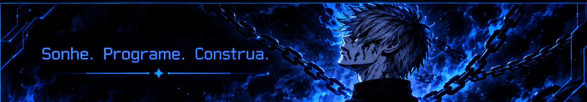

  

<h3 align="center">✦ Sobre mim ✦</h3>

  Olá! Sou <strong>Eduarda Ricardo</strong>, estudante de
  <strong>Sistemas para Internet</strong> e desenvolvedora
  <strong>Full Stack</strong>.

  Gosto de transformar ideias em soluções digitais,
  sempre aprendendo e explorando novas tecnologias.

  🚀 Em constante evolução, buscando novos desafios e oportunidades na tecnologia.

 

<h3 align="center">✦ Tecnologias & Ferramentas ✦</h3>

  Tecnologias e ferramentas que utilizo no desenvolvimento dos meus projetos.

  

<h3 align="center">✦ Projeto em destaque ✦</h3>

  <h3>🌐 CidaLink</h3>

  

    Plataforma web desenvolvida para aproximar cidadãos e administração pública,
    permitindo registrar ocorrências urbanas e acompanhar suas atualizações.
  

  

    O projeto conta com autenticação de usuários, publicação de ocorrências,
    notificações, painel administrativo, acessibilidade e tradução de conteúdo.
  

   
  

    <strong>💻 Tecnologias utilizadas</strong>
  

  
  
  
  
  

   
  

 

<h3 align="center">✦ Linguagens e estatísticas ✦</h3>

<table align="center">
  <tr>
    <td align="center" width="50%">
      
    </td>
    <td align="center" width="50%">
      
    </td>
  </tr>
</table>

 

  

 

<h3 align="center">✦ Vamos nos conectar? ✦</h3>

  
  

 

  

 

  <em>“I am made of dreams, courage, and all the things I have yet to become.”</em>

